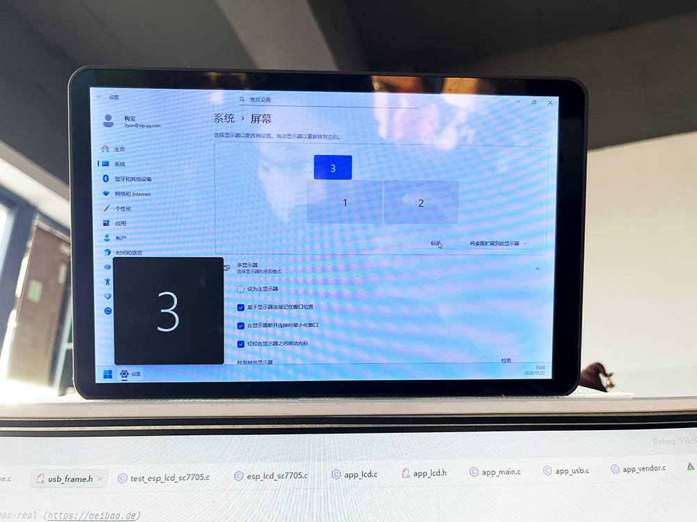

# ESP32-P4 USB 副屏

把一块 SC7705 MIPI-DSI 屏幕（800x1280 竖屏）变成 Windows 的 USB 扩展显示器。

- **平台**：ESP32-P4（芯片 v3.0+）+ ESP-IDF v5.5
- **屏幕**：SC7705 800x1280，RGB565，2 data lane MIPI-DSI，≈46 fps
- 无触摸、无音频
- 在系统屏幕里可以设置横屏或者竖屏
- 分辨率只支持1280x800



## PC 侧使用

1. 安装乐鑫官方签名驱动（base 项目 chuanjinpang/win10_idd 的 fork）：[下载](https://dl.espressif.com/AE/esp-iot-solution/xfz1986_usb_graphic_250224_rc_sign.exe)
2. 设备上电，USB 连接电脑
3. Windows 显示设置中把该屏幕方向选为"纵向"

驱动按 USB vendor 字符串动态解析分辨率（`R1280x800`），也支持注册表覆盖（`HKLM\SYSTEM\CurrentControlSet\Services\<服务名>\Parameters\udisp` 字符串值）。

## 构建与烧录

```bash
. ~/esp/esp-idf/export.sh
idf.py set-target esp32p4   # 首次
idf.py all
idf.py flash monitor
```

- 依赖由组件管理器按 `main/idf_component.yml` 自动拉取
- USB 参数（PID / 帧率 / JPEG 质量等）在 `main/Kconfig.projbuild`，可 menuconfig 调整

## 目录结构

```
├── main/                  # 主组件：入口、LCD 流水线、USB 收帧/组帧
│   ├── app_lcd.c          #   SC7705 初始化 + 解码/旋转两级流水线 + PPA 直写
│   ├── app_usb.c 等       #   tinyusb 设备栈 + vendor 收帧
│   └── tusb/              #   tusb_config + 描述符（vendor 字符串是 Windows 驱动握手协议，勿改格式）
├── components/
│   └── esp_lcd_sc7705/    # 屏幕驱动组件（SC7705 800x1280 @ 2lane RGB565）
├── managed_components/    # 组件管理器自动拉取，你初始化后会自动创建的，github里没有是正常的不要慌
├── partitions.csv         # 分区表（factory 8M）
└── sdkconfig              # 项目配置
```

## 硬件参数（实测定型）

| 项目 | 值 |
|---|---|
| 屏幕 | SC7705 MIPI-DSI 800x1280 竖屏 RGB565 |
| MIPI | 2 data lane + 1 clock lane；lane 600 Mbps（此面板 DPHY RX 实测封顶），DPI 80 MHz |
| 垂直时序 | VSync=4 VBP=10 VFP=156（V_total 1450 ≈46 Hz） |
| LCD 复位 | GPIO36 |
| LCD 背光 | GPIO24，LEDC PWM 20 kHz，80% 占空比 |
| 供电 | MIPI PHY：LDO 通道 3 @ 2500 mV；IO 电压域 3.3 V；屏电源板载直供 |
| 内存 | 32 MB PSRAM（帧缓冲/解码缓冲全走 PSRAM），16 MB flash |

## 关键实现点

- PPA SRM 旋转角实测用 270°
- 芯片 ≥ v3.0 时 DPHY PLL 参考时钟必须选 XTAL（`MIPI_DSI_PHY_PLLREF_CLK_SRC_DEFAULT`）
- DSI host 寄存器覆写：`frame_bta_ack_en=0`（消帧首抖动）、`eotp_tx_en=1`（关闭会出现右侧黑斑）
- PHY LP↔HS 转换时序覆写（100/200/92/256），治行首数据丢失
- USB vendor 字符串 `esp32p4udisp0_R1280x800_...` 是 Windows 驱动握手协议

## 致谢

- Windows IDD 驱动基于 chuanjinpang/win10_idd 的乐鑫 fork

## 查看更多信息

[访问梅宝的博客 - meibao.de](https://meibao.de)

## 许可证

本项目采用 [PolyForm Noncommercial 1.0.0](https://polyformproject.org/licenses/noncommercial/1.0.0) 协议发布：仅限非商业用途（个人学习、爱好项目、教育/公益等），禁止任何商业用途。详见 [LICENSE](LICENSE)。